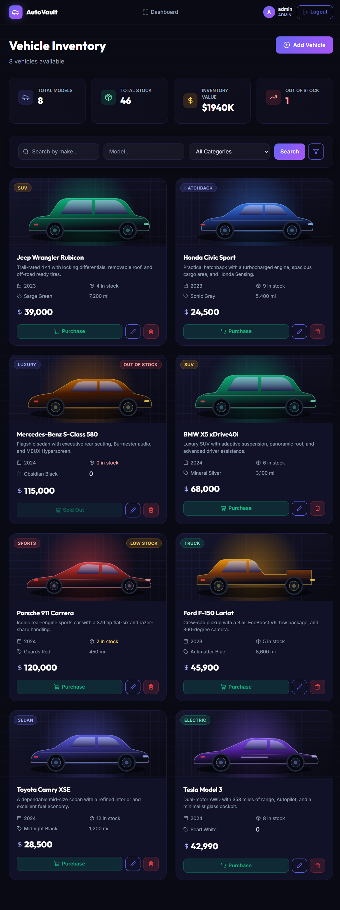

# 🚗 AutoVault — Car Dealership Inventory System

A full-stack **Car Dealership Inventory System** built with **Test-Driven Development (TDD)**.
It combines a RESTful Node.js/TypeScript API, a persistent SQLite-compatible database
(libSQL/Turso in production), JWT authentication, role-based access control, and a
premium dark-mode React SPA.

**Live demo:** [autovault-inventory.vercel.app](https://autovault-inventory.vercel.app)  
**API:** [car-dealership-api-liard.vercel.app/api/health](https://car-dealership-api-liard.vercel.app/api/health)  
**Repository:** [github.com/anupshenoym/car-dealership-inventory-system](https://github.com/anupshenoym/car-dealership-inventory-system)



---

## 📋 Table of Contents

- [Project Overview](#-project-overview)
- [Screenshots](#-screenshots)
- [Tech Stack](#-tech-stack)
- [Features](#-features)
- [Project Structure](#-project-structure)
- [Local Setup](#-local-setup)
- [Demo Accounts & Seed Data](#-demo-accounts--seed-data)
- [API Reference](#-api-reference)
- [Test Report](#-test-report)
- [TDD Approach](#-tdd-approach)
- [Deployment](#-deployment)
- [My AI Usage](#-my-ai-usage)

---

## 🏎️ Project Overview

AutoVault is a dealership inventory platform where:

- **Customers** can register, log in, browse the inventory, search/filter vehicles, and purchase a vehicle while stock lasts.
- **Admins** can add, edit, delete, and restock vehicles.
- **Every inventory mutation** is protected by JWT authentication, and admin-only routes are guarded by role checks.

The database layer uses **libSQL**, the open-source SQLite-compatible engine behind
Turso. In local development it persists to `backend/data/dealership.db`; in
production it talks to a hosted Turso database through the same async client API.
That means the app keeps real persistence on a serverless host (Vercel) without a
native SQLite build step.

---

## 📸 Screenshots

| Login | Inventory dashboard |
|-------|---------------------|
|  |  |

| Admin add-vehicle form | Search / filter results |
|------------------------|-------------------------|
|  |  |

**Deployed app (Vercel + Turso):**


---

## 🛠 Tech Stack

### Backend

| Technology | Purpose |
|-----------|---------|
| Node.js + TypeScript | Runtime & language |
| Express.js | HTTP framework |
| libSQL (Turso) | Persistent SQLite-compatible database |
| JSON Web Tokens | Authentication |
| bcryptjs | Password hashing |
| Jest + Supertest | Unit and integration testing |
| ts-jest | TypeScript test runner |

### Frontend

| Technology | Purpose |
|-----------|---------|
| React 19 + TypeScript | UI framework |
| Vite | Build tool & dev server |
| Tailwind CSS v4 | Utility-first styling |
| React Router v7 | Client-side routing |
| Zustand | Auth and toast state management |
| Axios | HTTP client |
| Lucide React | Icon library |

---

## ✨ Features

### Authentication
- ✅ Registration with email validation and bcrypt password hashing
- ✅ JWT login with a 24-hour token expiry
- ✅ Roles: `user` and `admin`
- ✅ Protected API routes and protected frontend routes
- ✅ Automatic logout on `401` responses

### Vehicle Inventory
- ✅ Create, read, update, and delete vehicles
- ✅ Search by make, model, category, and price range
- ✅ Pagination support
- ✅ Purchase flow that decrements stock
- ✅ Purchase button disabled when stock is zero
- ✅ Admin-only restock and delete operations
- ✅ Stock badges: In Stock, Low Stock, Out of Stock

### UI/UX
- ✅ Premium dark mode with glassmorphism and animated gradients
- ✅ Skeleton loading states
- ✅ Toast notifications for every action
- ✅ Inventory stats dashboard
- ✅ Responsive layout for desktop, tablet, and mobile
- ✅ Local SVG vehicle artwork so the demo works offline

---

## 📁 Project Structure

```text
TDD Kata Car Dealership Inventory System/
├── backend/
│   ├── src/
│   │   ├── config/
│   │   │   └── database.ts              # libSQL client, schema, query helpers
│   │   ├── controllers/
│   │   │   ├── authController.ts
│   │   │   └── vehicleController.ts
│   │   ├── middleware/
│   │   │   └── auth.ts                  # JWT authenticate + requireAdmin
│   │   ├── routes/
│   │   │   ├── auth.ts
│   │   │   ├── vehicles.ts
│   │   │   └── __tests__/
│   │   │       └── api.test.ts          # HTTP integration tests
│   │   ├── scripts/
│   │   │   └── seed.ts                  # Demo users + inventory
│   │   ├── services/
│   │   │   ├── authService.ts
│   │   │   ├── vehicleService.ts
│   │   │   └── __tests__/
│   │   │       ├── authService.test.ts
│   │   │       └── vehicleService.test.ts
│   │   ├── types/
│   │   │   └── index.ts
│   │   ├── app.ts                       # Express app
│   │   └── server.ts                    # Entry point
│   ├── api/
│   │   └── index.ts                     # Vercel serverless entry point
│   ├── .env.example
│   ├── jest.config.js
│   ├── tsconfig.json
│   ├── vercel.json
│   └── package.json
├── frontend/
│   ├── public/
│   │   ├── cars/                        # Local SVG car illustrations
│   │   └── favicon.svg
│   ├── src/
│   │   ├── api/client.ts                # Axios API client
│   │   ├── components/
│   │   │   ├── Navbar.tsx
│   │   │   ├── ToastContainer.tsx
│   │   │   ├── VehicleCard.tsx
│   │   │   └── VehicleForm.tsx
│   │   ├── pages/
│   │   │   ├── LoginPage.tsx
│   │   │   ├── RegisterPage.tsx
│   │   │   └── DashboardPage.tsx
│   │   ├── store/index.ts               # Zustand stores
│   │   ├── types/index.ts
│   │   ├── App.tsx
│   │   ├── index.css                    # Design system + responsive rules
│   │   └── main.tsx
│   ├── .env.example
│   ├── vite.config.ts
│   ├── vercel.json
│   └── package.json
├── docs/
│   ├── ai-logs/                         # Raw AI transcripts
│   └── screenshots/
├── .gitignore
├── PROMPTS.md                           # Raw AI chat logs
└── README.md
```

---

## 🚀 Local Setup

### Prerequisites

- Node.js v20.19+ (tested on Node 24)
- npm v9+
- Git

### 1. Clone the repository

```bash
git clone https://github.com/anupshenoym/car-dealership-inventory-system.git
cd "car-dealership-inventory-system"
```

### 2. Backend setup

```bash
cd backend
npm install
```

Copy the environment template and adjust the secret if you like:

```bash
cp .env.example .env
```

```env
PORT=3001
JWT_SECRET=replace-with-a-long-random-secret
FRONTEND_URL=http://localhost:5173
NODE_ENV=development

# Optional: point at Turso instead of backend/data/dealership.db
# TURSO_DATABASE_URL=libsql://your-db-your-org.turso.io
# TURSO_AUTH_TOKEN=your-turso-auth-token
```

Start the API:

```bash
npm run dev
```

The API runs at `http://localhost:3001`.

### 3. Seed demo data (recommended)

In a second terminal:

```bash
cd backend
npm run seed
```

This creates the demo accounts and eight vehicles. The script is idempotent —
running it again will not duplicate users or vehicles.

### 4. Frontend setup

```bash
cd frontend
npm install
npm run dev
```

The frontend runs at `http://localhost:5173`. Vite proxies `/api` requests to
`http://localhost:3001`.

### 5. Production build (optional)

```bash
cd backend && npm run build
cd ../frontend && npm run build
```

---

## 🔑 Demo Accounts & Seed Data

| Role | Email | Password |
|------|-------|----------|
| Admin | `admin@dealership.com` | `Admin@123` |
| User | `user@dealership.com` | `User@123` |

The login screen has **Demo User** and **Demo Admin** buttons that fill these
credentials automatically.

> **Security note:** this kata allows choosing the `admin` role at registration so
> reviewers can exercise admin features without a separate provisioning step. In a
> production system, public registration would always create a `user`, and admin
> accounts would be created by an invite-only process or a CLI script.

---

## 📡 API Reference

Base URL (local): `http://localhost:3001/api`  
Base URL (deployed): `https://car-dealership-api-liard.vercel.app/api`

### Auth Endpoints (Public)

| Method | Endpoint | Description |
|--------|----------|-------------|
| POST | `/api/auth/register` | Register a new user and receive a JWT |
| POST | `/api/auth/login` | Log in and receive a JWT |
| GET | `/api/health` | Health check |

**Register**

```http
POST /api/auth/register
Content-Type: application/json

{
  "email": "new@example.com",
  "password": "secret123",
  "role": "user"
}
```

**Login**

```http
POST /api/auth/login
Content-Type: application/json

{
  "email": "admin@dealership.com",
  "password": "Admin@123"
}
```

Both endpoints return:

```json
{
  "message": "Login successful.",
  "user": { "id": "...", "email": "...", "role": "admin", "createdAt": "..." },
  "token": "eyJhbGciOi..."
}
```

### Vehicle Endpoints (Protected)

Send the token on every request:

```http
Authorization: Bearer <token>
```

| Method | Endpoint | Description | Role |
|--------|----------|-------------|------|
| GET | `/api/vehicles?page=1&limit=20` | List all vehicles (paginated) | Any |
| GET | `/api/vehicles/search` | Search with filters | Any |
| GET | `/api/vehicles/:id` | Get a single vehicle | Any |
| POST | `/api/vehicles` | Add a new vehicle | Any authenticated |
| PUT | `/api/vehicles/:id` | Update a vehicle | Any authenticated |
| DELETE | `/api/vehicles/:id` | Delete a vehicle | **Admin** |
| POST | `/api/vehicles/:id/purchase` | Purchase (decrement stock) | Any authenticated |
| POST | `/api/vehicles/:id/restock` | Restock (increment stock) | **Admin** |

### Search Parameters

```http
GET /api/vehicles/search?make=Toyota&model=Camry&category=SUV&minPrice=20000&maxPrice=50000&page=1&limit=12
```

All filters are optional and can be combined.

### Vehicle Payload

```json
{
  "make": "Toyota",
  "model": "Camry XSE",
  "year": 2024,
  "category": "Sedan",
  "price": 28500,
  "quantity": 12,
  "color": "Midnight Black",
  "mileage": 1200,
  "description": "A dependable mid-size sedan.",
  "imageUrl": "/cars/sedan.svg"
}
```

### Status Codes

| Code | Meaning |
|------|---------|
| 200 | Success |
| 201 | Resource created |
| 400 | Validation error |
| 401 | Missing/invalid token or bad credentials |
| 403 | Authenticated but not an admin |
| 404 | Vehicle or route not found |
| 409 | Duplicate email or out-of-stock purchase |
| 500 | Unexpected server error |

---

## 🧪 Test Report

The backend has **57 passing tests** across 3 suites. A captured run of the full
suite is available in [`docs/test-report.txt`](docs/test-report.txt).

```text
Test Suites: 3 passed, 3 total
Tests:       57 passed, 57 total
Snapshots:   0 total
Time:        ~6.4s

File                   | % Stmts | % Branch | % Funcs | % Lines
-----------------------|---------|----------|---------|--------
All files              |   88.07 |       72 |   86.48 |    87.9
 src                   |    91.3 |       60 |      75 |    91.3
  app.ts               |    91.3 |       60 |      75 |    91.3
 src/config            |   66.66 |    22.22 |      70 |   68.42
  database.ts          |   66.66 |    22.22 |      70 |   68.42
 src/controllers       |   76.54 |    35.48 |      90 |   76.54
  authController.ts    |     100 |    66.66 |     100 |     100
  vehicleController.ts |   70.31 |       28 |    87.5 |   70.31
 src/middleware        |      95 |      100 |     100 |      95
  auth.ts              |      95 |      100 |     100 |      95
 src/routes            |     100 |      100 |     100 |     100
  auth.ts              |     100 |      100 |     100 |     100
  vehicles.ts          |     100 |      100 |     100 |     100
 src/services          |   99.15 |    86.59 |     100 |     100
  authService.ts       |     100 |      100 |     100 |     100
  vehicleService.ts    |   98.79 |     84.7 |     100 |     100
```

Run the suite:

```bash
cd backend
npm test
```

### Test Coverage Breakdown

| Test Suite | Tests | Focus |
|-----------|-------|-------|
| `authService.test.ts` | 11 | Registration validation, password hashing, login, duplicate emails |
| `vehicleService.test.ts` | 27 | CRUD, search, pagination, stock, purchase, restock, validation |
| `api.test.ts` | 19 | Full HTTP flows, JWT protection, admin authorization, status codes |
| **Total** | **57** | |

---

## 🔄 TDD Approach

The backend was built test-first:

1. **RED** — Wrote failing tests for the expected service behaviour and HTTP contracts.
2. **GREEN** — Implemented the minimum service/controller/route code to make them pass.
3. **REFACTOR** — Extracted the database helpers, centralized error mapping, and kept the suite green.

The tests cover happy paths, validation failures, authorization failures, duplicate
emails, unknown IDs, out-of-stock purchases, and invalid restock amounts.

> The original build session was completed in a separate environment. The raw
> Antigravity transcript is preserved in [`PROMPTS.md`](PROMPTS.md) and
> `docs/ai-logs/antigravity-transcript.jsonl` so the test-first sequence can be
> inspected directly.

---

## ☁️ Deployment

The app is deployed on **Vercel** with **Turso** as the persistent database.

| Component | URL |
|-----------|-----|
| Frontend | [autovault-inventory.vercel.app](https://autovault-inventory.vercel.app) |
| API | [car-dealership-api-liard.vercel.app](https://car-dealership-api-liard.vercel.app) |
| Health check | [car-dealership-api-liard.vercel.app/api/health](https://car-dealership-api-liard.vercel.app/api/health) |
| Database | Turso (hosted libSQL) |

### Architecture

- `frontend/` is a static Vite build served by Vercel.
- `backend/` runs as a Vercel serverless function (`api/index.ts`) behind a
  catch-all rewrite in `backend/vercel.json`.
- Data lives in Turso, so it survives serverless cold starts and redeploys.
  Vercel's own filesystem is ephemeral, which is why the API does not rely on a
  local SQLite file in production.

### Backend deployment

1. Create a Vercel project with root directory `backend`.
2. Add a Turso database (Vercel Marketplace → Turso Cloud, or the Turso dashboard).
3. Set these environment variables:

   ```env
   TURSO_DATABASE_URL=libsql://your-db-your-org.turso.io
   TURSO_AUTH_TOKEN=your-turso-auth-token
   JWT_SECRET=a-long-random-secret
   FRONTEND_URL=https://your-frontend.vercel.app
   NODE_ENV=production
   ```

4. Seed the remote database once (with the Turso variables exported):

   ```bash
   cd backend
   npm run seed
   ```

5. Deploy:

   ```bash
   vercel --prod
   ```

### Frontend deployment

1. Create a Vercel project with root directory `frontend`.
2. Set `VITE_API_URL=https://your-api.vercel.app/api`.
3. Deploy:

   ```bash
   vercel --prod
   ```

`frontend/vercel.json` rewrites client-side routes to `index.html`, so React
Router deep links work on refresh.

### Alternative hosts

The backend also runs on Render, Railway, Fly.io, or any Node host with
`npm install && npm run build` and `npm start`. If you use the local SQLite file
instead of Turso, mount a persistent disk at `backend/data`.

---

## 🤖 My AI Usage

### Tools Used

- **Antigravity IDE (Google DeepMind)** — primary assistant for the original build.
  The model selected for that session was **Claude Sonnet 4.6 (Thinking)**.
- **OpenCode** — completion and verification session, using **DeepSeek V4.1 Flash Free**.

### How I Used AI

1. **Architecture and planning** — I used Antigravity to brainstorm the layered
   structure (`routes → controllers → services → database`) and to choose a
   stack that would run without native build tools.

2. **Test generation (TDD)** — I described the intended behaviour of each service
   and asked the assistant to draft tests covering happy paths, validation, and
   error cases. I reviewed each test before running it and kept the red/green
   cycle visible in the transcript.

3. **Boilerplate reduction** — Auth middleware, CORS setup, Express route wiring,
   and the initial React component shells were generated as boilerplate, then
   reviewed and customized.

4. **Debugging** — When `better-sqlite3` failed because Visual Studio C++ build
   tools were missing, the assistant helped me pivot to `sql.js`, a pure-JS
   SQLite build that still persists to a real database file.

5. **UI and design system** — I specified the visual direction (dark mode,
   glassmorphism, indigo/violet gradients) and iterated on the React components,
   CSS custom properties, responsive rules, and SVG vehicle artwork.

6. **Completion pass** — In OpenCode I used the assistant to find missing frontend
   dependencies, fix TypeScript `verbatimModuleSyntax` errors, add demo seeding,
   capture screenshots, and assemble this README and `PROMPTS.md`.

7. **Deployment and persistence** — For the live demo I used the assistant to
   migrate the data layer from `sql.js` to `@libsql/client`, provision a Turso
   database through the Vercel Marketplace, deploy the frontend and API as two
   Vercel projects, and verify CORS, JWT auth, search, purchase, restock, and
   role checks against the deployed URLs.

### Reflection

AI was a genuine force multiplier, especially for test scaffolding and for
recovering from environment-specific problems (native modules, missing npm
packages, TypeScript configuration). It was not a replacement for judgement:
the first frontend build failed because runtime dependencies were missing, the
initial SQLite choice needed a fallback, and the AI-generated UI still required
manual layout, responsiveness, and copy decisions.

The biggest lesson was to keep AI output on a short leash: review every test,
run the suite after every change, and treat generated code as a draft rather
than a finished artifact.

### Raw Logs

The complete raw AI conversation logs are in:

- [`PROMPTS.md`](PROMPTS.md) — readable transcript of both sessions
- [`docs/ai-logs/antigravity-transcript.jsonl`](docs/ai-logs/antigravity-transcript.jsonl) — original build session
- [`docs/ai-logs/opencode-session.jsonl`](docs/ai-logs/opencode-session.jsonl) — completion session chat export
